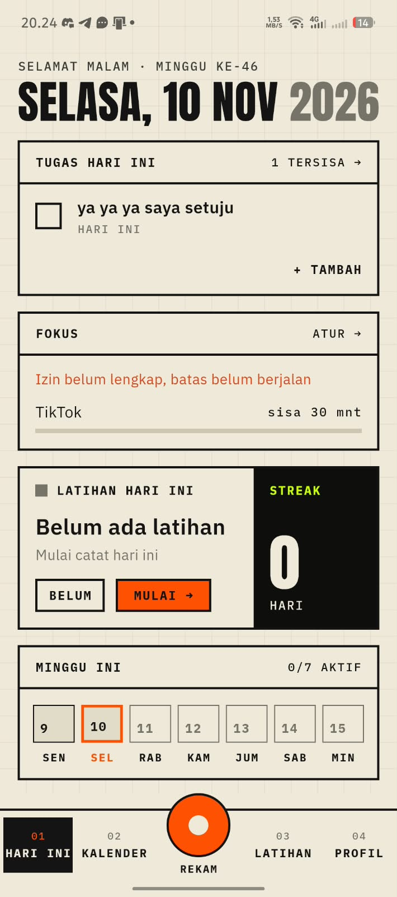
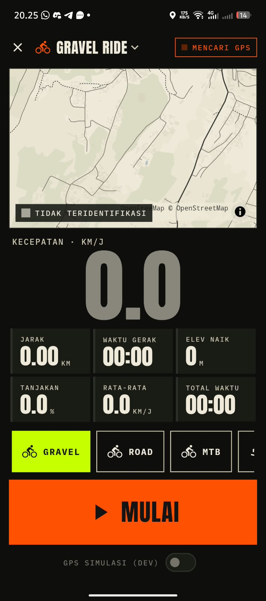
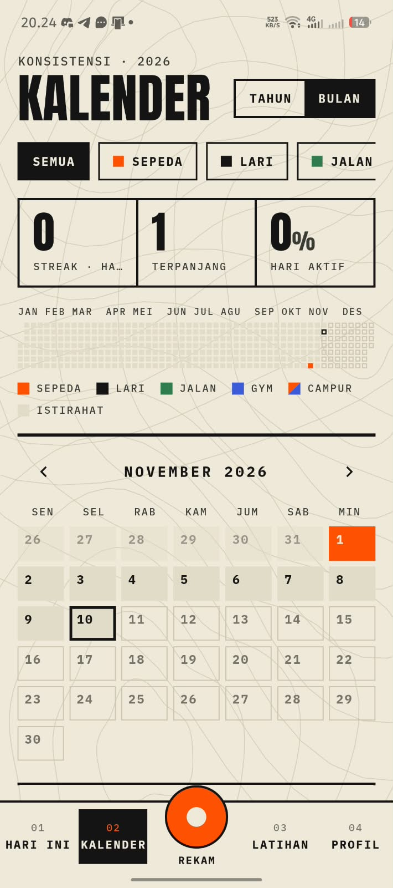
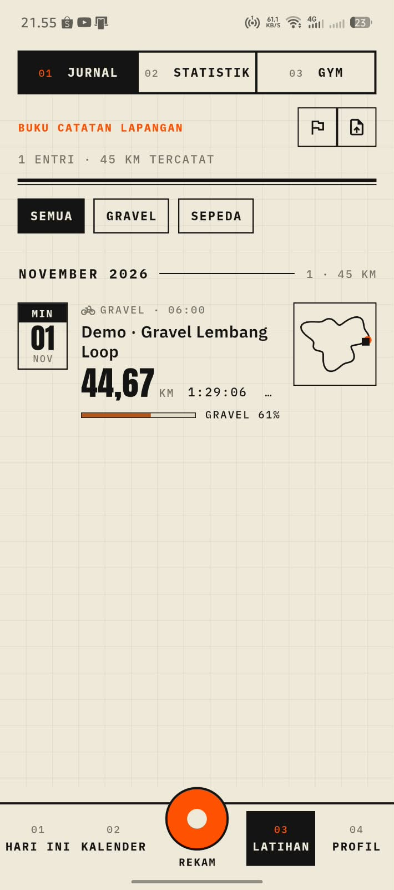
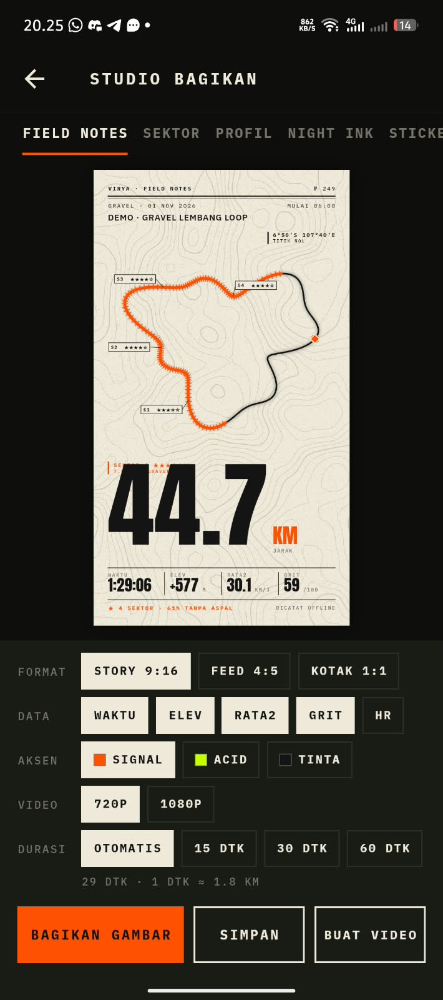
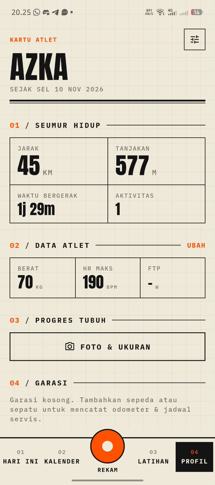
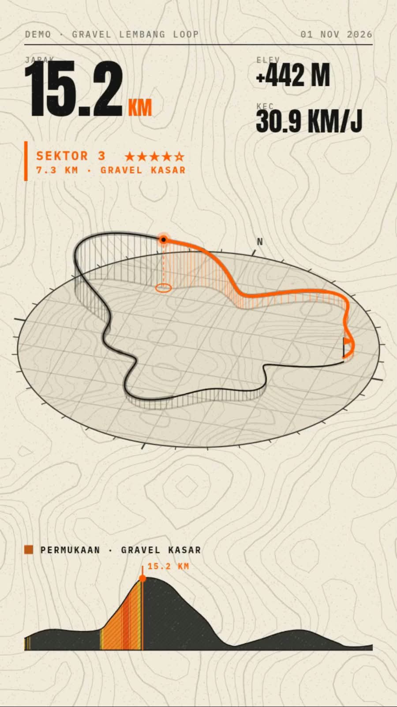

# Virya

Aplikasi pelacak kebugaran dan pembangun konsistensi harian berbasis offline.

Virya menggabungkan pelacakan rute GPS untuk olahraga luar ruangan, modul latihan beban di gym, kalender konsistensi aktivitas, pencatatan to-do cepat, batas layar ponsel, dan dokumentasi progres fisik. Aplikasi ini bekerja tanpa akun, tanpa koneksi internet ke server luar, dan tanpa biaya langganan. Seluruh data disimpan langsung di penyimpanan internal ponsel Anda.

---

## Tampilan Aplikasi

<p align="center">
  
  
  
</p>

<p align="center">
  
  
  
</p>

---

## Daftar Isi
1. [Prinsip Utama](#prinsip-utama)
2. [Cara Pasang di HP Android](#cara-pasang-di-hp-android)
3. [Fitur Utama](#fitur-utama)
   - [Dasbor Hari Ini](#1-dasbor-hari-ini)
   - [Perekaman GPS dan Analisis Rute](#2-perekaman-gps-dan-analisis-rute)
   - [Kalender Konsistensi dan Heatmap](#3-kalender-konsistensi-dan-heatmap)
   - [Jurnal Latihan dan Catatan Lapangan](#4-jurnal-latihan-dan-catatan-lapangan)
   - [Studio Bagikan dan Video Rekap 3D](#5-studio-bagikan-dan-video-rekap-3d)
   - [Modul Gym dan Latihan Beban](#6-modul-gym-dan-latihan-beban)
   - [Fokus dan Pembatas Layar](#7-fokus-dan-pembatas-layar)
   - [Catat Cepat Tugas di Notifikasi](#8-catat-cepat-tugas-di-notifikasi)
   - [Profil Atlet dan Garasi](#9-profil-atlet-dan-garasi)
   - [Peta Offline Tanpa Sinyal](#10-peta-offline-tanpa-sinyal)
   - [Cadangan Data dan Ekspor GPX](#11-cadangan-data-dan-ekspor-gpx)
4. [Panduan Pengembang](#panduan-pengembang)
5. [Lisensi](#lisensi)

---

## Prinsip Utama

* **Tanpa Server dan Tanpa Akun**: Anda tidak perlu mendaftar email, membuat kata sandi, atau memasukkan nomor telepon. Aplikasi langsung dapat digunakan begitu selesai dipasang.
* **Database Mandiri di Ponsel**: Riwayat rute, catatan set beban, to-do list, dan foto progres tubuh tersimpan di database SQLite lokal (`virya.sqlite`) di dalam memori ponsel Anda sendiri.
* **Gaya Visual Field Notes**: Terinspirasi dari buku jurnal ekspedisi lapangan klasik. Menggunakan latar kertas bernuansa krem, garis kontur topografi halus, tipografi monospaced yang mudah dibaca saat bergerak, serta aksen warna oranye sinyal.

---

## Cara Pasang di HP Android

### Langkah 1: Unduh File APK
Buka halaman [Releases](https://github.com/AbdurRouf05/virya/releases) di repositori ini, lalu unduh file rilis terbaru:
* **`app-release.apk`**: Kompatibel dengan semua ponsel Android (Android 7.0 hingga Android 15).

### Langkah 2: Pasang File
1. Buka file APK yang sudah diunduh melalui aplikasi File Manager atau browser di ponsel Anda.
2. Jika muncul peringatan keamanan tentang instalasi dari sumber luar, pilih **Setelan**, lalu aktifkan opsi **Izinkan dari sumber ini**.
3. Ketuk **Instal** dan tunggu hingga selesai.

### Langkah 3: Pengaturan Penghemat Baterai (Penting)
Agar perekaman rute GPS tidak terhenti saat layar ponsel mati atau terkunci:
1. Buka **Setelan Ponsel** > **Aplikasi** > pilih **Virya**.
2. Masuk ke menu **Penghemat Baterai** (atau Penggunaan Baterai).
3. Ubah pilihannya menjadi **Tidak Ada Pembatasan** (*Unrestricted*).

### Langkah 4: Mode Ramah Bank pada Fitur Fokus
Modul Fokus di Virya dirancang agar tidak memicu sistem keamanan aplikasi perbankan (seperti SeaBank, BCA, Livin Mandiri, dan BRImo):
* Cukup berikan izin **Akses Penggunaan** (*Usage Access*) saat diminta di dalam aplikasi.
* Izin ini aman dan tidak pernah diblokir oleh aplikasi perbankan. Anda tidak perlu menyalakan izin Aksesibilitas.

---

## Fitur Utama

### 1. Dasbor Hari Ini
<p align="center">
  
</p>

Layar utama yang merangkum rutinitas harian Anda dalam satu halaman:
* Tanggal, minggu ke berapa dalam setahun, dan ucapan waktu dinamis.
* Daftar tugas to-do yang harus diselesaikan hari ini.
* Pemantau sisa kuota fokus aplikasi media sosial.
* Ringkasan status latihan harian dan penghitung streak konsistensi mingguan.
* Tombol oranye di tengah bawah untuk memulai aksi cepat: rekam GPS, mulai sesi gym, catat tugas baru, atau simpan foto progres tubuh.

---

### 2. Perekaman GPS dan Analisis Rute
<p align="center">
  
</p>

Perekam aktivitas luar ruangan dengan tampilan kontras tinggi yang jelas terbaca di bawah terik matahari:
* **Mode Olahraga**: Sepeda gravel, sepeda balap (road), sepeda gunung (MTB), lari jalan raya, trail running, hiking, dan jalan kaki santai.
* **Metrik Komprehensif**: Kecepatan saat ini, kecepatan rata-rata, jarak tempuh, waktu bergerak, elevasi naik, serta persentase kemiringan tanjakan secara langsung.
* **Peta Kontur Topografi**: Menampilkan garis jalur langsung di atas peta medan offline.
* **Sensor Detak Jantung Bluetooth (BLE)**: Mendukung koneksi nirkabel ke monitor denyut jantung standar (seperti Garmin, Polar, Magene, dan CooSpo).

---

### 3. Kalender Konsistensi dan Heatmap
<p align="center">
  
</p>

Visualisasi konsistensi latihan sepanjang tahun:
* **Heatmap 52 Minggu**: Kotak matriks aktivitas tahunan untuk memantau seberapa konsisten Anda berlatih setiap minggu.
* **Pembeda Kategori Olahraga**: Kotak heatmap otomatis diberi kode warna sesuai jenis kegiatan: oranye untuk sepeda, hijau tua untuk lari, hijau toska untuk jalan kaki, dan biru untuk gym.
* **Ringkasan Angka**: Penghitung streak berjalan, streak terpanjang yang pernah dicapai, serta persentase hari aktif sepanjang tahun.

---

### 4. Jurnal Latihan dan Catatan Lapangan
<p align="center">
  
</p>

Buku catatan digital untuk mengarsipkan seluruh sesi kegiatan yang telah Anda selesaikan:
* Menampilkan ringkasan jarak, waktu total, profil elevasi, serta peta thumbnail dari rute yang dilalui.
* Analisis permukaan jalan: menghitung persentase jalur aspal dibanding jalur non-aspal (tanah, kerikil, atau bebatuan).
* Filter praktis untuk menyortir riwayat berdasarkan kategori olahraga.

---

### 5. Studio Bagikan dan Video Rekap 3D
<p align="center">
  
  &nbsp;&nbsp;&nbsp;&nbsp;
  
</p>

Ubah data rekaman olahraga menjadi materi visual berkualitas tinggi untuk dibagikan ke media sosial:
* **Pilihan Format Gambar**: Tersedia rasio vertikal Story (9:16), format feed Instagram (4:5), dan persegi (1:1).
* **Kartu Field Notes**: Infografis bergaya lembar ekspedisi resmi yang menampilkan rincian jarak, grafik elevasi, skor kekasaran medan (GRIT), dan pembagian sektor jalur.
* **Video Animasi 3D**: Pembuat video gerak MP4 yang menelusuri lintasan rute GPS Anda dalam perspektif tiga dimensi di atas peta kontur berputar.

---

### 6. Modul Gym dan Latihan Beban
Pencatat program latihan kekuatan di pusat kebugaran:
* Pustaka gerakan bawaan yang mencakup kelompok otot dada, punggung, kaki, bahu, lengan, dan inti tubuh.
* Pencatatan beban (kg), jumlah repetisi, set pemanasan, dan nilai RPE per set.
* Timer istirahat cerdas yang otomatis berhitung mundur setelah set latihan selesai dicentang.
* Perhitungan otomatis beban terberat dan perkiraan kekuatan 1RM (*One Rep Max*).

---

### 7. Fokus dan Pembatas Layar
Bantu menjaga kendali waktu dari distraksi media sosial:
* Tentukan batas waktu harian untuk aplikasi tertentu (contoh: membatasi pemakaian TikTok atau Instagram selama 30 menit per hari).
* **Mode Ramah Bank**: Berjalan menggunakan izin analitik resmi Android (*Usage Access*) tanpa menyalakan Aksesibilitas. Peringatan akan dikirimkan melalui notifikasi layar saat kuota tercapai, sehingga rekening m-banking Anda tetap aman dan tidak pernah terblokir.
* Opsi darurat untuk menambah waktu 5 menit, maksimal 1 kali per aplikasi setiap hari.

---

### 8. Catat Cepat Tugas di Notifikasi
Kelola daftar rencana tanpa repot membuka aplikasi:
* Notifikasi minimalis permanen di bilah status Android yang memiliki kolom ketik langsung.
* Anda cukup menarik panel notifikasi ponsel, mengetik tugas yang baru terpikirkan, lalu menekan tombol kirim. Tugas akan langsung masuk ke daftar agenda.
* Dukungan tombol pintas di menu Quick Settings atas ponsel dan widget interaktif di layar beranda.

---

### 9. Profil Atlet dan Garasi
<p align="center">
  
</p>

Pusat statistik jangka panjang dan perawatan perlengkapan:
* **Statistik Kumulatif**: Total jarak seumur hidup, akumulasi tanjakan, total jam bergerak, dan jumlah sesi latihan.
* **Data Tubuh**: Catatan berat badan berkala, denyut jantung maksimum, dan target kebugaran.
* **Kamera Bayangan Panduan (*Ghost Silhouette*)**: Membantu memposisikan postur tubuh sejajar dengan foto sebelumnya saat mengambil foto progres fisik.
* **Garasi Perlengkapan**: Catat odometer jarak tempuh untuk tiap sepeda dan sepatu lari agar Anda tahu kapan waktunya mengganti rantai, ban, atau melakukan servis berkala.

---

### 10. Peta Offline Tanpa Sinyal
Navigasi tetap berjalan saat Anda berada di jalur pedalaman atau pegunungan tanpa jangkauan sinyal operator:
* Masuk ke menu **Pengaturan** > **Peta Offline** > **Unduh Wilayah**.
* Tentukan radius wilayah (antara 10 hingga 100 km) di sekitar koordinat lokasi Anda.
* Peta vektor akan tersimpan di ponsel sehingga rute dan nama jalan tetap tampil utuh saat ponsel berada dalam mode pesawat.

---

### 11. Cadangan Data dan Ekspor GPX
* **Ekspor GPX dan TCX**: Seluruh aktivitas rute dapat diunduh kapan saja ke format standar industri agar dapat diimpor ke Strava, Garmin Connect, atau platform lain.
* **Cadangan Utuh**: Simpan seluruh riwayat latihan dan foto progres tubuh ke dalam satu file ZIP arsip lokal untuk dipindahkan ke ponsel baru.

---

## Panduan Pengembang

Jika Anda ingin berkontribusi atau mengompilasi kode program Virya secara mandiri:

### Prasyarat
* Flutter SDK versi 3.29.0 atau yang lebih baru
* Dart SDK versi 3.7.0
* Android SDK dengan compileSdk 35
* Java Development Kit (JDK) 17 atau 21

### Langkah Kompilasi
```bash
# 1. Kloning repositori
git clone https://github.com/AbdurRouf05/virya.git
cd virya

# 2. Unduh paket dependensi
flutter pub get

# 3. Jalankan pengujian unit
flutter test

# 4. Bangun file APK rilis
flutter build apk --release
```

Hasil file APK yang siap dipasang akan berada di direktori `build/app/outputs/flutter-apk/app-release.apk`.

---

## Lisensi

Virya dirilis sebagai perangkat lunak bebas di bawah lisensi [GNU General Public License v3.0 (GPL-3.0)](LICENSE).
Data peta dasar bersumber dari kontributor [OpenStreetMap](https://www.openstreetmap.org/copyright) (ODbL).
